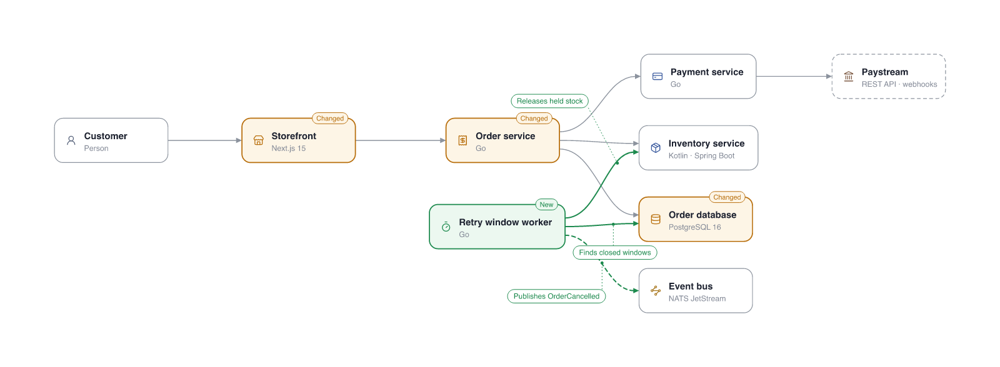

# Poney


**Poney is an open format for explaining software with diagrams.**

Your coding agent reads the repository and writes a `.poney` file with diagrams, code excerpts and a walkthrough. Open it in Poney Studio to follow the explanation and ask questions. You can also embed the diagrams in your app or export them as SVG or PNG.

<picture>
  <source media="(prefers-color-scheme: dark)" srcset="media/change-overview-dark.png">
  
</picture>

<sub>In <a href="spec/examples/kestrel-commerce.poney">Kestrel Commerce</a>, customers have 30 minutes to retry a declined payment. The new worker (green) releases their stock when time runs out. Existing parts that change are marked in amber.</sub>

## Two kinds of walkthrough

- **A change** helps you review a pull request. It shows what users will see before and after the change, then walks through the code and tests behind it. The diagrams mark what’s new, changed or removed.
- **A tour** introduces a codebase. Follow a request through the system, open a group to look inside a service, or ask the agent about a line of code in the walkthrough.

Both use the same model to draw architecture, map, sequence, data flow, activity, entity relationship, state machine, use case and dependency diagrams.

## Quick start

Poney needs Node 22 or later.

**Ask your agent for a tour.** In Claude Code, add Poney’s MCP server with this command.

```sh
claude mcp add poney -- npx -y --package=@hattoriai/poney poney-mcp
```

Ask *“Give me a Poney tour of this repository, then wait for my questions.”* The agent checks the tour against the code and opens it in Studio, where you can ask follow-up questions.

**Open Poney Studio** to read a `.poney` file or connect an agent. Studio supports Claude Code, Codex, OpenCode, GitHub Copilot and other agents that use the [Agent Client Protocol](https://agentclientprotocol.com).

```sh
npx @hattoriai/poney studio
```

**Export a diagram** as SVG or PNG for a pull request or your documentation.

```sh
npx @hattoriai/poney render shop.poney --view architecture --format svg
```

**Draw a diagram in a web page.** Install the renderers and the packages they use. Add `@hattoriai/poney-react` for React.

```sh
npm install @hattoriai/poney-diagrams @hattoriai/poney-layout @hattoriai/poney-core
```

See [Use Poney in your app](docs/embedding.md).


## For agents

1. Run `poney brief` for a change or `poney brief --tour` for a tour. The MCP tool `poney_guide` provides the same guide and worked example.
2. Write the `.poney` file. Use `poney excerpt` or `poney_excerpt` to copy code directly from the source.
3. Check the walkthrough against the repository with `poney check <file> --git <repo>` or `poney_check`. Use the hints to fix any errors.
4. Inspect each scene as a PNG with `poney render <file> --scene <id>` or `poney_render`.
5. Open the walkthrough in Studio with `poney_open`. Use `poney_wait` and `poney_reply` to answer questions from the reader.

For structured output, get the JSON Schema with `poney schema` or `poney_schema`. See the [CLI and MCP reference](docs/agents.md) for all commands and tools.

For work on Poney itself, follow the [repository instructions](AGENTS.md).

## Packages

| Package | What it does |
|---|---|
| [`@hattoriai/poney`](packages/agent) | The CLI (`poney`), the MCP server (`poney-mcp`) and Poney Studio |
| [`@hattoriai/poney-core`](packages/core) | Reads, validates, upgrades and edits documents. Includes Mermaid import and depends only on Zod |
| [`@hattoriai/poney-layout`](packages/layout) | Positions elements and routes connections for each diagram |
| [`@hattoriai/poney-diagrams`](packages/diagrams) | Draws diagrams as SVG with no framework, and provides their stylesheet |
| [`@hattoriai/poney-react`](packages/react) | Draws diagrams in React |
| [`@hattoriai/poney-render`](packages/render) | Renders a view as SVG or PNG in Node |
| [`@hattoriai/poney-ext-ownership`](packages/ext-ownership), [`@hattoriai/poney-ext-security`](packages/ext-security) | Describe team ownership, trust zones and sensitive data |

All packages have the same version. See the [changelog](CHANGELOG.md).

## Documentation

| Guide | What it covers |
|---|---|
| [Poney Studio](docs/studio.md) | Read a walkthrough, explore a diagram or ask an agent about the code |
| [Agents, the CLI and MCP](docs/agents.md) | Write, check and share walkthroughs |
| [Use Poney in your app](docs/embedding.md) | Draw a diagram in React, customise its appearance or render it in Node |
| [Extending Poney](docs/extending.md) | Add an extension, importer, overlay or diagram type |
| [Architecture](docs/architecture.md) | Find your way around the repository and follow a document from JSON to diagram |
| [The format](spec/SPEC.md) | The specification, with the [JSON Schema](spec/poney.schema.json) and a [conformance suite](spec/conformance) |

## The format

A `.poney` file is JSON. The **model** describes the system, each **view** selects what to show, and **presentation** sets the colours, shapes and line styles. A **walkthrough** guides the reader through those views. Diagrams use familiar notations, including C4 for architecture, UML for behaviour and crow’s foot for data relationships.

The current draft is 0.2.0. Poney upgrades older files when it opens them. If you’re writing a reader in another language, use the JSON Schema to check the structure and the conformance suite to test your implementation against [the specification](spec/SPEC.md).

## Contributing

Start with the [contributing guide](CONTRIBUTING.md). Maintainers can find release instructions in the [release guide](RELEASING.md).

## License

[MIT](LICENSE).
