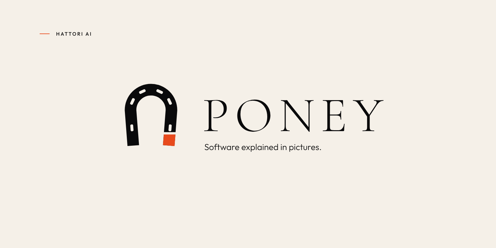

# Poney



**Explain software in diagrams that agents can write and people can read.**

A walkthrough explains software in scenes. A **change** explains one change: what changes for a person, a verdict, then focused scenes with new, changed and removed parts marked, numbered notes, the proof and the code. A **tour** teaches a codebase as it is: its parts as maps with groups that open and close, the main flows, excerpts of the code — and then the reader asks the agent questions in the Studio.

Poney has three parts:

1. **A format.** A `.poney` file is JSON that describes software — its parts, connections, data and behaviour — and walkthroughs that explain a change. Agents write it; Poney lays it out and draws it. The format is an internal draft, not a public standard: see [`spec/SPEC.md`](spec/SPEC.md).
2. **An agent kit.** A guide, a checker that explains how to fix problems, a headless renderer so an agent can see its pictures, a CLI (`poney`) and an MCP server.
3. **Poney Studio**, where people read walkthroughs, explore diagrams (architecture, sequence, data flow, activity, entity relationship, state machine, use case, dependency, map), and answer or leave notes for the agent, live.

## Run it

```sh
npm install
npm run studio     # Poney Studio with its local hub at http://127.0.0.1:5319 (after npm run build)
npm run dev        # Studio dev server at http://localhost:5173; starts the local hub too (or uses a running one)
npm test           # format, layout and conformance tests
npm run typecheck  # every package
npm run build      # production build of the Studio
npm run spec       # regenerate spec/poney.schema.json and the example document
npm run poney -- check spec/examples/walkthrough.poney
```

Node 20 or later. The Studio works on its own in the browser. With `npm run studio`, a small local hub also lets it start agents and talk to agents in their own sessions; it listens on 127.0.0.1 only.

## Working with agents

Two ways, and they work together:

- **Start an agent from the Studio.** "Connect an agent" picks the folder it works in (a folder on this computer, or a Git address that Poney clones into `~/.poney/workspaces`) and the agent: Claude Code, OpenAI Codex, OpenCode, GitHub Copilot, or any other agent that speaks the [Agent Client Protocol](https://agentclientprotocol.com) (by its command). The agent uses your own sign-in. Poney gives it the Poney MCP tools and tells it how to use them, so the tours and walkthroughs it writes open in the Studio at once. You talk to it in the agent panel; it shows what the agent does and asks you before it acts when the agent asks.
- **Use your own agent session.** Add the Poney MCP server to Claude Code (or any MCP client). When a Studio hub runs, the MCP server attaches to it by itself (or set `PONEY_HUB_URL`); otherwise it starts its own hub. Ask: "Give me a Poney tour of this code, then wait for my questions." Your questions in the agent panel reach it through `poney_wait`; its answers come back with `poney_reply`.

Both kinds of agent share one document and one conversation, so the Studio is the same either way.

**Documents are files**, as notebooks are in Livebook. When an agent starts in a folder, the Studio opens that folder's project, saved to `docs/poney/<folder>.poney` once there is something to keep (or opened from there, when the file already exists). Every change, from the agent or from you, is saved to the file, and a change to the file on disk (an editor, `git pull`) shows in the Studio. "Open a file" browses this computer for `.poney` files. Commit the files with the code: a tour then lives with the code it explains, and `poney check --git` shows when it no longer matches.

## For agents

An agent learns the format from the guide, writes a `.poney` file, checks it, looks at each scene, and shows it to a person.

**CLI** (`packages/agent/bin/poney.mjs`, or `npm run poney --`):

```sh
poney brief                                   # the guide and a complete example
poney check lockout.poney                     # errors and warnings, each with a fix hint
poney render lockout.poney --scene states     # PNG (or --format svg), exactly as the Studio draws it
poney render shop.poney --view architecture --format svg   # any view of any type, like a Mermaid CLI
poney schema                                  # JSON Schema, for structured output
poney import diagram.mmd --out diagram.poney  # Mermaid to Poney
poney import                                  # importers, and what each would read here
poney import schema . --into app.poney        # add tables and foreign keys from the database schema
poney overlay coverage app.poney .            # live facts on the parts: test coverage, recent changes
```

**MCP server** (`packages/agent/bin/poney-mcp.mjs`, stdio). This repository's `.mcp.json` registers it for Claude Code. In another project:

```sh
claude mcp add poney -- node /path/to/poney/packages/agent/bin/poney-mcp.mjs
```

| Tool | What it does |
|---|---|
| `poney_guide` | The guide and a complete example, for a change (default) or a tour (`topic: "tour"`). |
| `poney_schema` | The JSON Schema. |
| `poney_check` | Validates and lints; errors and warnings with paths and fix hints. With `repo` (and `rev`: a commit, `a..b`, or `working`), also proves that the code shown is in the diff or the file at those lines, and that cited tests and `sourceRefs` exist. |
| `poney_render` | One scene as a PNG, so the agent can see it. Without a document, renders what is open in the Studio. |
| `poney_open` | Shows a document live in Poney Studio. Every open window updates. |
| `poney_read` | What the person sees and does: the scene, the selection, answers to questions, notes for the agent, the question thread, and the document if they changed it. |
| `poney_wait` | Waits for the next question the person asks in the Studio ("Ask the agent"), with the scene they were on. |
| `poney_reply` | Answers in the Studio thread; a reply can link to a scene. |
| `poney_excerpt` | A code block copied exactly from a file, for a scene's `code`. |
| `poney_import` | Adds what an importer reads in the repository (a database schema, the module imports) to the open document. It only adds. |
| `poney_overlay` | Live facts about the parts, through their source paths: test coverage, recent changes. |

**Live Studio.** The MCP server runs a small local hub (port 5319 and up, or `PONEY_PORT`). After `npm run build`, the hub also serves the Studio, so the person opens the address `poney_open` gives. With `npm run dev`, open the Studio with `?live=http://127.0.0.1:5319`. The top bar shows **Live** when linked. Each scene has "Add a note for the agent"; answers and notes reach `poney_read`.

**What a good walkthrough looks like** is in [`packages/agent/brief.md`](packages/agent/brief.md), with [`brief-change.md`](packages/agent/brief-change.md) and [`brief-tour.md`](packages/agent/brief-tour.md): small scenes, plain words, every ref resolved, every test real.

**To learn a codebase**, ask your agent (with the MCP server): "Give me a Poney tour of this repository, then wait for my questions." It writes a tour, checks it against the code, opens it in the Studio, and answers what you ask with `poney_wait` and `poney_reply`.

## What is in the repository

```
spec/                      The format (internal draft)
  SPEC.md                  Specification
  poney.schema.json        JSON Schema (shape and defaults)
  examples/                Example documents (.poney)
  conformance/             Valid and invalid documents with expected results

packages/
  core/      @poney/core    Schema, validation and lints, model queries, commands, extensions,
                            projections, JSON and Mermaid adapters. Depends only on Zod.
  layout/    @poney/layout  Diagram graph → positioned scene. ELK and custom layouts. No UI framework.
  react/     @poney/react   Renderers for every diagram type and for walkthrough stories, for any
                            React app (the host passes selection and interaction); and
                            @poney/react/static renders any view to SVG and PNG in Node.
  agent/     @poney/agent   The guide, the CLI and the MCP server (src/), and:
                              src/live/    the live hub: state, HTTP server, and the API MCP tools use
                                           (in this process, or a hub in another one)
                              src/agents/  agents the Studio starts over ACP: providers, the bridge,
                                           workspaces (folders and Git clones)
                              src/plugins/ importers, overlays, and the plugin loader
  ext-ownership/            Example extension: teams, ownership, on-call, team map.
  ext-security/             Extension: trust zones, sensitive data, protected connections; lints.
  examples/                 The Kestrel Commerce sample model.

apps/
  studio/                   Poney Studio.
```

Each package depends only on the ones above it. A test in `@poney/core` fails if the format package ever imports React, a layout engine, or another UI library.

## Walkthroughs

The Studio opens on a start page: open a `.poney` file (or drop it, or paste it), reopen recent work, or connect an agent. A new tab always opens on the start page; reloading a tab keeps its document. Recent documents are in the sidebar. **Try the example** opens Kestrel Commerce, a sample online store with a change walkthrough ("Let customers retry a declined card") and a tour ("A first walk through Kestrel"). `?example=kestrel` in the address opens it directly.

- **The story and the overview map.** Switch Before / Change / After: the new retry worker and its lines appear and disappear in place.
- **Scenes.** Scroll. The diagram on the right stays in view and its camera moves to each scene's focus; the rest of the view dims. The numbered notes in the text match the numbers in the diagram; hover one to light up the other.
- **Each scene** carries what happens in each case, the proof (a missing test is called out), an optional question for the reader, and the diff with notes.
- **The diagram is a canvas.** Pinch or ⌘/Ctrl + scroll zooms the diagram, never the page; drag pans; double-click zooms in; "Reset view" frames the scene again. "Expand" opens it near full screen.
- Reading progress and answers are kept in this browser.

Scenes can also say what a reader must see, by meaning: a `trace` (a path the reader plays step by step, and the camera follows), `effects` (`flow`, `attention`, `hot-path`, `slow`, `failing`, `blocked`) and `badges` (short facts such as "p95 840 ms"). The Studio animates them; a PNG draws them still and numbers the path; nothing moves for readers who ask for reduced motion.

A walkthrough is plain data in the document (`walkthroughs`, SPEC section 5.8): marks on model elements, removed elements as they were, and scenes that point at views. Story renderers (`packages/react`) draw map, sequence and state scenes in a crisp style; other view types fall back to their explorer renderer.

Two layout features exist for stories: **map views** (small composed pictures with soft curves, labels placed clear of boxes, and `passThrough` to draw a line through a hop that does not matter, such as a gateway), and **focused sequences** (only the messages a scene names, with their participants, in compact columns).

## The explorer

Open **Explore the whole system** and you see the **Kestrel Commerce** sample: an online store with a storefront, an API gateway, seven services, five databases, a cache, an event bus, and two outside providers. One model drives fourteen views:

| Category | Views |
|---|---|
| Overview | System context, Architecture, Payment retry map |
| Behavior | Sign-in sequence, Checkout sequence, Payment retry sequence, Checkout activity, Order lifecycle |
| Data | Checkout data flow, Data model |
| Structure | Order service components, Service dependencies |
| Capabilities | What people can do |
| Ownership (extension) | Team map |

Things to try:

- Select the **Payment service** in Architecture. The inspector shows its connections, data, team and the behaviors it takes part in. Select **Open checkout sequence**: the sequence opens with the Payment service still selected and centered.
- In the checkout sequence, step through the messages with the arrows in the toolbar.
- In the Data model, select `orders.id` to see every table that refers to it, across databases.
- In Order service components, turn on **Follow dependencies all the way**.
- Press <kbd>⌘K</kbd> to search parts, tables, behaviors and diagrams.
- Paste a Mermaid diagram, or Poney JSON, anywhere in the Studio. It opens as a new project. **Export → Copy JSON** copies the current model.
- Press <kbd>?</kbd> for every keyboard shortcut.

## How the data model works

A document has three layers (SPEC sections 5–7):

- **Model** — what the software is. Entities (`service`, `database`, `person`…), relationships, data types with fields and keys, data relations with cardinality, data flows, behaviors (interactions, processes, state machines) and capabilities. Every element has a stable id.
- **Views** — what one diagram shows and how it is organized. A view references model ids; it never copies a definition. Each diagram type has its own structure: a sequence view points at an interaction (with ordered messages and nested fragments), an ERD view lists tables, an architecture view lists entities, groups and what starts collapsed.
- **Presentation** — how things look: shape, pigment and icon per kind, line style per relationship kind, overrides per element and per view.

What is selected, hovered or zoomed is **not** in the document. It lives in the Studio's store.

`validateDocument()` checks a document in three passes: shape (Zod, the same rules as the JSON Schema), referential integrity (rules R1–R13), and extensions.

```ts
import { validateDocument, indexOf } from '@poney/core'

const result = validateDocument(json, { extensions: [ownership] })
if (result.ok) {
  const idx = indexOf(result.document)
  idx.behaviorsInvolving('payment-service') // → checkout, checkout-process, order-lifecycle
  idx.viewsShowing({ kind: 'entity', id: 'payment-service' })
}
```

## How diagrams are projected and laid out

```
document ─▶ validate ─▶ model ─▶ projection ─▶ layout ─▶ scene ─▶ renderer
            @poney/core          @poney/core   @poney/layout       apps/studio
```

- **Projections** (`packages/core/src/projections`) are pure functions from a model and a view to a diagram graph. For example, the architecture projection nests entities by containment and group, and lifts relationships to the nearest visible container when a group is closed.
- **Layouts** (`packages/layout/src`) turn a projection into a **scene**: plain rectangles, routed points and label boxes, plus `anchors` keyed by element reference so the canvas can frame any element by its identity. Architecture, data flow, ERD and state machines use ELK (layered, orthogonal routing). Sequence, activity (swimlanes), use case and dependency diagrams use purpose-built layouts, because a timeline, a set of lanes or a set of bands is not a generic graph.
- Text measuring is injectable (`setTextMeasurer`), so layouts also run in Node, in a worker, or with a server-side font engine.

`layoutView(doc, view, options)` lays out any view. Options are reader choices that do not change the document: which groups are open, which tables show every field.

## How rendering works

The renderers are in **`@poney/react`**, not in the Studio, so any app can draw a Poney document its own way, as with Mermaid. The Studio is one host among others. Every diagram type is a **diagram module** (`packages/react/src/diagrams/<type>/index.tsx`):

```ts
interface DiagramModule {
  key: string            // 'sequence', or 'ownership/team-map' for extension views
  label: string
  icon: LucideIcon
  howToRead: string      // one or two sentences on how to read it
  Renderer: FC<{ scene; view }>
  Legend?: FC<{ view }>  // the key to the symbols
  initialView?: 'fit' | 'start'
}
```

Renderers draw SVG from a scene that `@poney/layout` computed. They do not compute layout and do not change the model. Everything else comes from the **host**, through `RenderProvider`:

| | What it gives | Without it |
|---|---|---|
| `idx` | The model index (required) | — |
| `bind(ref, label)` | Click, hover and keyboard behavior for an element | Plain SVG with `data-ref` |
| `selection`, `hover` | What to light up | Nothing dims |
| `viewState`, `setViewState` | Open groups, expanded tables | Each view keeps its own while shown |
| `still` | A picture: no controls | Controls are drawn |
| `ZoomProvider` | The zoom level, for level of detail | 1 |

```tsx
import { RenderProvider, diagramFor } from '@poney/react'
import { indexOf } from '@poney/core'
import { layoutView } from '@poney/layout'

const view = doc.views[0]
const scene = await layoutView(doc, view)
const { Renderer } = diagramFor(view)!
<RenderProvider value={{ idx: indexOf(doc) }}>
  <svg viewBox={`0 0 ${scene.width} ${scene.height}`}><Renderer scene={scene} view={view} /></svg>
</RenderProvider>
```

The Studio's host (`apps/studio/src/story/StudioRender.tsx`) passes its store's selection and view state, and a `bind` with its own behavior: rename on double-click, the context menu, pointing for the agent. The Studio also adds its chrome: the `Canvas` (zoom, pan, fit, the tooltip), and toolbar buttons per diagram type (`apps/studio/src/renderers/tools.tsx`).

**Headless.** `@poney/react/static` draws any view to SVG or PNG in Node, with the real fonts: `poney render doc.poney --view <id> [--format svg]`. A test renders every view of the Kestrel example.

React Flow is not used. With a custom SVG canvas, every diagram type gets its own interaction model, and the model never has to look like a node-and-edge list. A Canvas or WebGL renderer can draw the same scenes.

## How to add a diagram type

1. **Format.** Add the view shape to `packages/core/src/schema/views.ts` and the referential checks to `validation/validate.ts`. Add `viewShows` cases to `model/query.ts` so search and navigation can find elements in it. Document it in `spec/SPEC.md`.
2. **Projection** (optional). Add a pure function under `packages/core/src/projections`.
3. **Layout.** Add `layoutX(doc, view, options): SceneBase` in `packages/layout/src` and a case in `layoutView`. Put an anchor in the scene for every element a person can select.
4. **Renderer.** Add `packages/react/src/diagrams/x/index.tsx` exporting a `DiagramModule`, and add it to `BUILT_IN_DIAGRAMS` in `diagrams/registry.ts`. Take everything app-specific from the host (`useRenderIndex`, `useRenderBind`, `useRenderSubject`, `useViewState`). If it needs a toolbar button in the Studio, add it to `apps/studio/src/renderers/tools.tsx`.
5. **Inspector.** If the diagram introduces a new kind of element reference, add a body for it in `components/inspector/bodies.tsx`.

To add a diagram type **without changing the format**, write an extension instead.

## How to write an extension

`packages/ext-ownership` is a complete example. It has three parts.

**Format half** (no UI, any runtime):

```ts
export const ownership = defineExtension({
  name: 'ownership',
  version: '0.1.0',
  entityKinds: { team: { label: 'Team' } },             // used as "ownership/team"
  facets: { entity: OwnershipFacet },                   // ext.ownership on entities
  views: { 'team-map': { label: 'Team map', schema: TeamMapData } },
  validate(doc, { index, report }) { /* teams must exist */ },
  lint(doc, { index, warn }) { /* optional: warnings in the extension's own terms */ },
})
```

`validate` reports errors (the document is invalid); `lint` gives warnings with a stable code and a hint, like the core lints. `packages/ext-security` uses `lint` to warn where personal data or secrets cross a trust zone without encryption or a named authentication. It needs no view type of its own: zones are drawn with an architecture view's groups.

**Drawing part** (`@poney/ext-ownership/layout` and `/diagram`): a layout and a renderer for the view type, for any app. Register them with `registerExtensionLayout(...)` (`@poney/layout`) and `registerDiagram(...)` (`@poney/react`); the CLI does, so `poney render` draws the team map too.

**Studio part** (`apps/studio/src/extensions/ownership`): an inspector section, registered with `registerStudioExtension(...)`.

A document declares the extensions it uses. Readers that do not know an optional extension keep its data and still work; readers that do not know a *required* one refuse the document (SPEC section 8).

## Plugins: importers and overlays

Plugins run in the local hub, next to the code, and the Studio shows what they return.

- **Importers** read a source and add what they find to a document. They only add: what the document already has keeps its words. Built in: `schema` (tables, columns and foreign keys from `db/schema.rb`, SQL DDL or `schema.prisma`) and `js-modules` (modules and who imports whom, from JavaScript and TypeScript imports, across npm workspaces and tsconfig paths). In the Studio: **Import from the code…** in the project menu.
- **Overlays** read live facts and mark the parts they concern, through each part's `sourceRefs`, without changing the document. Built in: `coverage` (from the last lcov, Istanbul, SimpleCov or ExCoveralls report) and `churn` (commits in the last 90 days). In the Studio: **Facts** in the top bar; walkthrough scenes and explorer diagrams show the facts as badges, and mark the parts that need a look.

Agents use both through `poney_import` and `poney_overlay`, and people through `poney import` and `poney overlay`.

**Your own plugins.** A plugin is a module whose default export comes from `definePlugin` (`@poney/agent/plugins`), with `importers`, `overlays` and format `extensions`:

```js
import { definePlugin } from '@poney/agent/plugins'

export default definePlugin({
  name: 'sentry',
  overlays: [{
    id: 'sentry', name: 'Errors', description: 'Unresolved errors per part, from Sentry.',
    detect: () => (process.env.SENTRY_AUTH_TOKEN ? ['SENTRY_AUTH_TOKEN'] : []),
    async read(dir, doc) { /* … */ return { title: 'Errors', at: new Date().toISOString(), marks: [], notes: [] } },
  }],
})
```

List it in `~/.poney/plugins.json` (or the file `PONEY_PLUGINS` names): `{ "plugins": ["/path/to/sentry.mjs"] }`. A plugin runs code on your computer, so the list lives in your home folder, never in a project: opening or cloning a repository does not load its code. A plugin with the same id as a built-in one replaces it.

## How visual editing fits in

Editing is not in this version, but the architecture is ready for it:

- **Commands** (`packages/core/src/commands`) are the only way to change a document: `entity.add`, `entity.update`, `entity.remove`, `relationship.*`, `view.addEntity`, `layout.move`, `presentation.override`. Each is plain JSON, so it can be logged, sent to collaborators, or replayed.
- `applyCommand` is pure, returns a new document, and refuses changes that would break referential integrity.
- Every command has a **scope** — `semantic`, `layout` or `presentation` — so moving a box never touches the model, and renaming a service never touches positions.
- **Undo and redo** keep the previous immutable documents (`createHistory`, `execute`, `undo`, `redo`). The Studio store already holds a history and exposes `dispatch`, `undo` and `redo`.
- **Manual layout** goes into `view.positions`, separate from the model. The layouts already pass these positions to ELK as node coordinates; making ELK keep them fixed (an interactive layering strategy) is the next step, and the custom layouts need the same treatment.
- **Stable ids** mean selection, links and anchors survive edits.
- **Adapters** (`fromJSON`, `toJSON`, `fromMermaid`) show where import and export of other formats plug in.

A first editing feature would be: drag a node → `dispatch({ type: 'layout.move', ... })` → the layout cache misses for the new document → the layout runs again around the new position.

## Mermaid import

`fromMermaid(text)` converts `sequenceDiagram`, `flowchart`/`graph`, `stateDiagram(-v2)` and `erDiagram` into a Poney document with one view. Mermaid describes one picture; the import creates the entities, behaviors and data types that the picture implies. Styling directives are ignored.

## Using Poney without the Studio

```ts
import { parseDocument, applyCommand, toJSON, fromMermaid } from '@poney/core'
import { layoutView } from '@poney/layout'
import { RenderProvider, diagramFor } from '@poney/react'            // any view, in your React app
import { renderScene, renderScenePng } from '@poney/react/static'    // any view, to SVG or PNG in Node
```

Or from a terminal: `poney render doc.poney --view <id> --format svg --out view.svg`.

From another language: read [`spec/SPEC.md`](spec/SPEC.md), check shape with [`spec/poney.schema.json`](spec/poney.schema.json), implement rules R1–R14, and run the suite in [`spec/conformance`](spec/conformance).

## License

MIT. See [LICENSE](LICENSE).
