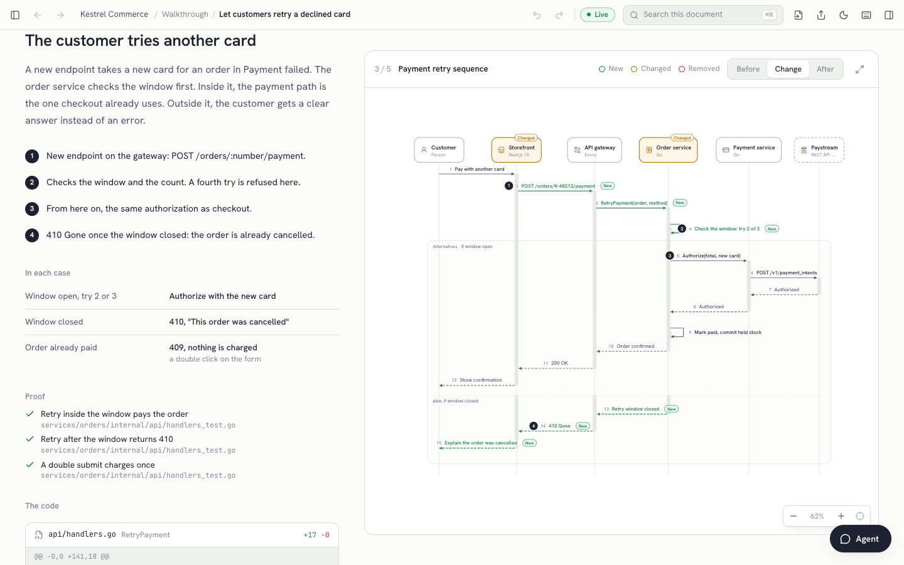

# Poney


**Explain software in diagrams that agents write and people read.**

An agent reads your code and writes a `.poney` file: the parts of the system, how they connect, its data and behaviour, and a walkthrough that explains it in scenes. Poney checks the file, lays it out and draws it, in Poney Studio, in your own app, or as SVG and PNG. Like Mermaid, the format is open, and anyone can render it.

<picture>
  <source media="(prefers-color-scheme: dark)" srcset="media/change-overview-dark.png">
  
</picture>

<sub>One change, as Poney draws it: the new worker, the parts that change and the lines that appear. Rendered by <code>poney render</code> from <a href="spec/examples/kestrel-commerce.poney">the example document</a>.</sub>

## Two kinds of walkthrough

- **A change** explains one change before a person reviews it: what changes for a person, a verdict, then focused scenes with new, changed and removed parts marked, numbered notes, the cases, the proof (the tests) and the code.
- **A tour** teaches a codebase as it is: its parts as maps with groups that open and close, the main flows, excerpts of the code. Then the reader asks the agent questions in the Studio, next to the diagram.

Behind both is one model, with diagrams of these types: architecture, map, sequence, data flow, activity, entity relationship, state machine, use case and dependency.

## Quick start

Poney needs Node 22 or later.

**Ask your agent for a tour.** Add the MCP server to Claude Code (or to any MCP client):

```sh
claude mcp add poney -- npx -y --package=@hattoriai/poney poney-mcp
```

Then ask: *"Give me a Poney tour of this repository, then wait for my questions."* The agent writes the tour, checks it against the code and opens it in Poney Studio. Your questions in the Studio go to the agent, and its answers come back there.

**Open the Studio** and connect an agent from there (Claude Code, Codex, OpenCode, GitHub Copilot, or any agent that speaks the [Agent Client Protocol](https://agentclientprotocol.com)), or open a `.poney` file:

```sh
npx @hattoriai/poney studio
```

**Render a diagram** to SVG or PNG, for docs, a pull request or CI:

```sh
npx @hattoriai/poney render shop.poney --view architecture --format svg
```

**Draw Poney in your own React app:**

```sh
npm install @hattoriai/poney-react @hattoriai/poney-layout @hattoriai/poney-core
```

See [Use Poney in your app](docs/embedding.md).



## For agents

If you are an agent that has to explain code with Poney:

1. Read the guide: `poney brief` (or `poney brief --tour`), or the MCP tool `poney_guide`. It has the format, the rules for a good walkthrough and a complete example.
2. Write the `.poney` file. Copy code with `poney excerpt` (`poney_excerpt`); do not retype it.
3. Check it: `poney check <file> --git <repo>` (`poney_check`). Fix each error with its hint.
4. Look at each scene: `poney render <file> --scene <id>` (`poney_render`) gives you a PNG.
5. Show it to the person: `poney_open`, then `poney_wait` and `poney_reply` for their questions.

The full list of commands and tools is in [Agents, the CLI and MCP](docs/agents.md). The JSON Schema is `poney schema` (`poney_schema`), for structured output.

If you are an agent that works *on* this repository, read [AGENTS.md](AGENTS.md).

## Packages

| Package | What it is |
|---|---|
| [`@hattoriai/poney`](packages/agent) | The CLI (`poney`), the MCP server (`poney-mcp`) and Poney Studio |
| [`@hattoriai/poney-core`](packages/core) | The format: schema, validation, upgrades, commands, Mermaid import. Depends only on Zod |
| [`@hattoriai/poney-layout`](packages/layout) | Lays a view out into a scene. No UI framework |
| [`@hattoriai/poney-react`](packages/react) | Renderers for every diagram type, and a plain stylesheet |
| [`@hattoriai/poney-render`](packages/render) | Any view to SVG or PNG, in Node |
| [`@hattoriai/poney-ext-ownership`](packages/ext-ownership), [`@hattoriai/poney-ext-security`](packages/ext-security) | Extensions: teams and ownership; trust zones and sensitive data |

All packages have the same version. See the [changelog](CHANGELOG.md).

## Documentation

| | |
|---|---|
| [Poney Studio](docs/studio.md) | Reading walkthroughs, exploring diagrams, working with agents, documents as files |
| [Agents, the CLI and MCP](docs/agents.md) | Every command and MCP tool, the live Studio, what makes a good walkthrough |
| [Use Poney in your app](docs/embedding.md) | The core API, the renderers and their host, styles and themes, headless rendering, Mermaid import |
| [Extending Poney](docs/extending.md) | Extensions, plugins (importers and overlays), new diagram types |
| [Architecture](docs/architecture.md) | The data model, the pipeline from document to picture, the repository, editing |
| [The format](spec/SPEC.md) | The specification, with the [JSON Schema](spec/poney.schema.json) and a [conformance suite](spec/conformance) |

## The format

A `.poney` file is JSON with three layers: the **model** (what the software is), **views** (what each diagram shows) and **presentation** (how things look), plus **walkthroughs**. It uses the names of the notations it draws: C4 for architecture, UML for sequences, activities, state machines and use cases, and crow's foot for data.

The format is a draft, at version 0.2.0. Readers upgrade older documents automatically, so a file written for an earlier version still opens. To read Poney from another language, implement [the specification](spec/SPEC.md), check shapes with the JSON Schema and run the conformance suite.

## Contributing

See [CONTRIBUTING.md](CONTRIBUTING.md). To release, see [RELEASING.md](RELEASING.md).

## License

MIT. See [LICENSE](LICENSE).
