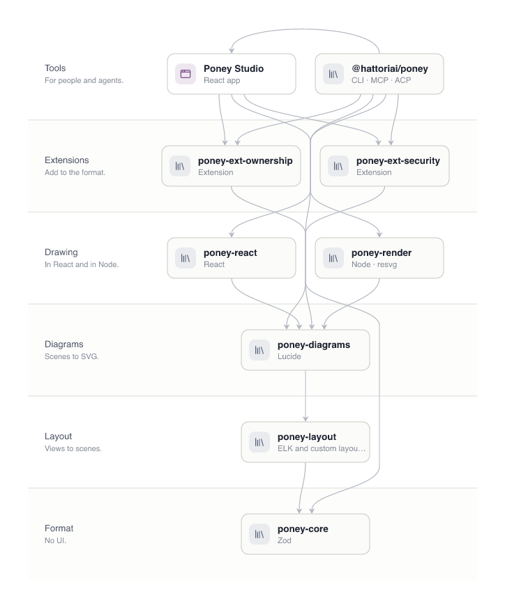
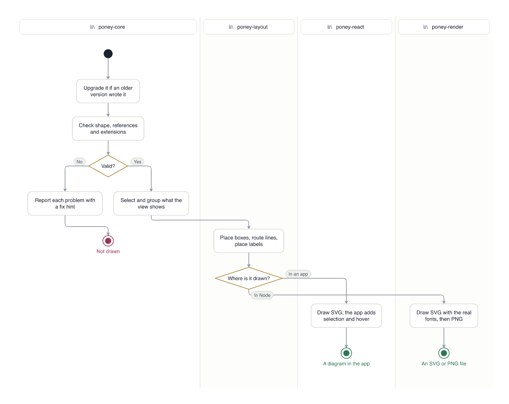

# Architecture

Poney draws the diagrams on this page from its own document, [`docs/poney/poney.poney`](poney/poney.poney). To explore it, open that file in Poney Studio. To render one view again, run `npm run poney -- render docs/poney/poney.poney --view packages`.

## The packages

<picture>
  <source media="(prefers-color-scheme: dark)" srcset="../media/architecture-packages-dark.png">
  
</picture>

Each arrow shows what a package uses directly; it gets the rest through that package. Under each name is the main library that the package builds on.

## The repository

```
spec/                         The format
  SPEC.md                     The specification
  poney.schema.json           JSON Schema generated by npm run spec
  examples/                   Example documents
  conformance/                Valid and invalid documents with expected results

packages/
  core/          @hattoriai/poney-core       Schema, validation and lints, upgrades, model queries,
                                             commands, extensions, projections, JSON and Mermaid
                                             adapters. Depends only on Zod.
  layout/        @hattoriai/poney-layout     Diagram layout using ELK and custom algorithms.
  diagrams/      @hattoriai/poney-diagrams   Renderers and CSS for diagrams and walkthrough scenes,
                                             with no framework: SVG markup, the DOM, or an adapter.
  react/         @hattoriai/poney-react      The renderers as React components.
  render/        @hattoriai/poney-render     SVG and PNG export in Node.
  agent/         @hattoriai/poney            Authoring guides (brief*.md), CLI and MCP server
                   src/live/                   Local server, document state and files
                   src/agents/                 Agent connections and workspaces
                                               (local folders and Git clones)
                   src/plugins/                Importers, overlays and the plugin loader
  ext-ownership/ @hattoriai/poney-ext-ownership   Teams, on-call contacts and the team map.
  ext-security/  @hattoriai/poney-ext-security    Trust zones, sensitive data, protected connections.
  examples/      (private)                   The Kestrel Commerce example, in TypeScript.

apps/
  studio/        (private)                   Studio ships with @hattoriai/poney.
```

The core package depends only on Zod. A test catches imports that would tie the format to React, a layout engine or another UI library.

## The data model

A `.poney` document has three layers. Sections 5–7 of the [specification](../spec/SPEC.md) define their fields.

- The **model** describes the software. It records entities such as people, services and databases, along with their relationships, data, behaviour and use cases. Each element has a stable ID.
- A **view** selects elements by ID and describes how to show them. A sequence view points to an interaction and its ordered messages. An entity relationship diagram lists tables. An architecture view can group services and specify which groups start collapsed.
- **Presentation** sets shapes, colours, icons and line styles. A document can override these for one element or view.

**Walkthroughs** live in the same file. Each scene refers to a view or defines its own. A change walkthrough marks what’s new, changed or removed and keeps enough detail to show removed elements as they were.

The app keeps track of the reader’s selection, hover and zoom level.

`validateDocument()` calls `upgradeDocument` in `packages/core/src/upgrade.ts` to bring older files up to date. It then checks the document’s structure with Zod, applies rules R1–R14 from the specification and checks any registered extensions.

## From document to picture

<picture>
  <source media="(prefers-color-scheme: dark)" srcset="../media/architecture-pipeline-dark.png">
  
</picture>

- A **projection** selects and groups the elements a view needs. For example, when you collapse a group in an architecture view, its connections move to the nearest visible container. See `packages/core/src/projections`.
- A **layout** calculates positions for boxes, connecting lines and labels. The result is a **scene**. Its `anchors` give the bounds of each element so the canvas can zoom to it. Architecture, data flow, entity relationship and state machine diagrams use ELK to route lines around boxes. Sequence, activity, use case and dependency diagrams have their own layouts in `packages/layout/src`.
- **Map views** can use `passThrough` to draw a connection through an intermediate step, such as an API gateway. **Focused sequences** show just the messages named in a scene and the participants that exchange them.
- A **renderer** draws the scene as SVG. The app supplies interactions such as selection and hover. See [Use Poney in your app](embedding.md#your-app-is-the-host).
- `@hattoriai/poney-render` uses the React renderers to export images in Node. Tests check that the export colours in `THEMES` match the stylesheet and that every view in the Kestrel example renders.

## Editing

When you rename a service in Studio, the edit goes through the same command API available to other apps.

- **Commands** in `packages/core/src/commands` are plain JSON, so you can store or replay them. Examples include `entity.update`, `view.addEntity`, `layout.move` and `presentation.override`.
- `applyCommand` returns a new document. It throws if an edit would leave a broken reference.
- Each command has a **scope**. Renaming a service is a `semantic` edit. Moving its box changes the `layout` of one view. Changing its colour is a `presentation` edit.
- **Undo and redo** use previous versions of the document. The history API provides `createHistory`, `execute`, `undo` and `redo`.
- **Manual layout** coordinates live in `view.positions`. Layouts that read them pass them to ELK as starting coordinates. Support for pinning elements in place is incomplete.
- **Stable IDs** keep selections, links and anchors pointing to the same element after a rename.

## The local hub

The hub is a local HTTP server on `127.0.0.1`. It saves the open document, watches its file for edits and sends updates to connected Studio windows using server-sent events. It also carries questions and replies between Studio and the agent. `poney studio` starts a hub. The MCP server connects to an existing hub or starts one of its own. The implementation lives in `packages/agent/src/live`.
