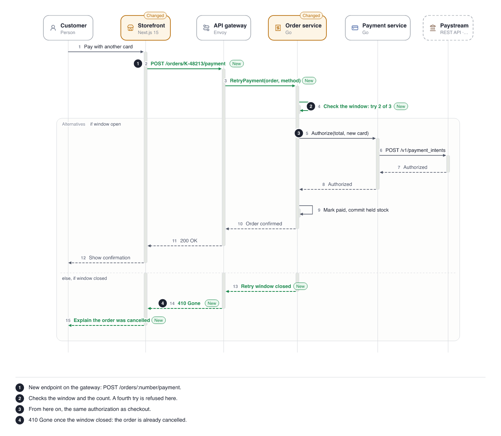

# Poney Studio

Use Poney Studio to read a walkthrough, explore the diagrams and ask the agent about the code.

```sh
npx @hattoriai/poney studio
```

Open the address printed in the terminal. Studio runs in your browser and uses a local server on `127.0.0.1` to save files and connect to agents.

## The start page

Open a `.poney` file, drop it onto the page, or paste its contents. Recent documents appear here too. Reloading the tab takes you back to your work.

**Try the example** opens Kestrel Commerce, a sample online store. Pick “A first walk through Kestrel” for a tour or “Let customers retry a declined card” to review a change. To link directly to the example, add `?example=kestrel` to the Studio URL.

## Reading a walkthrough

- In the change walkthrough, switch the overview map between **Before**, **Change** and **After** to see where the new retry worker fits.
- Scroll through the scenes. The diagram stays in view and highlights the part you’re reading about. Hover over a numbered note to see the step it describes.
- In “The customer tries another card”, the notes explain what happens if the customer retries too late or clicks twice. Below them are the tests for each case and the code they cover. Scenes can also flag a missing test or leave a question for the reader.
- Drag to pan. To zoom, pinch, double-click, or hold <kbd>⌘</kbd> or <kbd>Ctrl</kbd> while scrolling. **Reset view** brings the scene back into frame. **Expand** gives the diagram more room.
- Studio remembers your progress and answers in this browser.

<picture>
  <source media="(prefers-color-scheme: dark)" srcset="../media/change-sequence-dark.png">
  
</picture>

Some scenes include a path you can play one step at a time, with the diagram following along. Effects can highlight a slow or failing request, and badges can show details such as response times. Studio respects your reduced-motion setting. In a PNG, the steps are labelled in order.

## Exploring the whole system

Choose **Explore the whole system** to browse diagrams like these from Kestrel.

| Category | Views |
|---|---|
| Overview | System context, Architecture, Payment retry map |
| Behavior | Sign-in sequence, Checkout sequence, Payment retry sequence, Checkout activity, Order lifecycle |
| Data | Checkout data flow, Data model |
| Structure | Order service components, Service dependencies |
| Use cases | What people can do |
| Ownership (extension) | Team map |

- Select **Payment service** in **Architecture** to see its team, data and connections. Choose **Open checkout sequence** in the inspector to follow the same service into the sequence diagram.
- Use the toolbar arrows to step through the checkout messages in order.
- In **Data model**, select `orders.id` to see which tables refer to it, even across databases.
- In **Order service components**, choose **Follow dependencies all the way** to see indirect dependencies.
- Press <kbd>⌘K</kbd> or <kbd>Ctrl</kbd>+<kbd>K</kbd> to find a part, table, behaviour or diagram.
- Paste a Mermaid diagram or Poney JSON to open it as a new project. Choose **Export → Copy JSON** to copy the current document.
- Press <kbd>?</kbd> for the full list of keyboard shortcuts.

With a repository connected, choose **Facts** to see test coverage or recent changes for a part of the system. **Import from the code…** in the project menu lets you add tables or modules from the repository. See [Importers and overlays](extending.md#plugins-importers-and-overlays).

## Working with agents

- **Start an agent in Studio.** Choose **Connect an agent** and pick a local folder or a Git URL to clone into `~/.poney/workspaces`. Select Claude Code, OpenAI Codex, OpenCode or GitHub Copilot, or enter the command for another agent that uses the [Agent Client Protocol](https://agentclientprotocol.com). The agent uses your existing sign-in. Follow its work and respond to permission requests in the agent panel.
- **Choose the agent one time.** Each project has its own agent session and its own conversation. When you open a project, the agent starts there, or continues the project's earlier session. An agent can finish its answer while you look at another project. Poney keeps the agent you chose and each project's session in `~/.poney/sessions.json`.
- **Use an existing session.** Add the Poney MCP server to your agent. It connects to a running Studio server or starts one for you. To use a specific server, set `PONEY_HUB_URL`. See [Agents, the CLI and MCP](agents.md).

In either setup, **Ask the agent** includes the scene you’re reading with your question. Use the target button to point to a particular part of the diagram, or choose **Add a note for the agent** to leave a comment.

## Documents are files

When you connect an agent from the start page, Studio saves your walkthrough under `docs/poney/` in the repository. For a folder named `shop`, it opens `docs/poney/shop.poney`, or creates it when there’s a diagram or walkthrough to save.

Edits in Studio go straight to that file. Changes you make in an editor or pull from Git show up in Studio too. Use **Open a file** to browse for a walkthrough saved elsewhere.

Commit the walkthrough alongside the code it describes. Run `poney check <file> --git .` to check its excerpts and references against the current commit.
